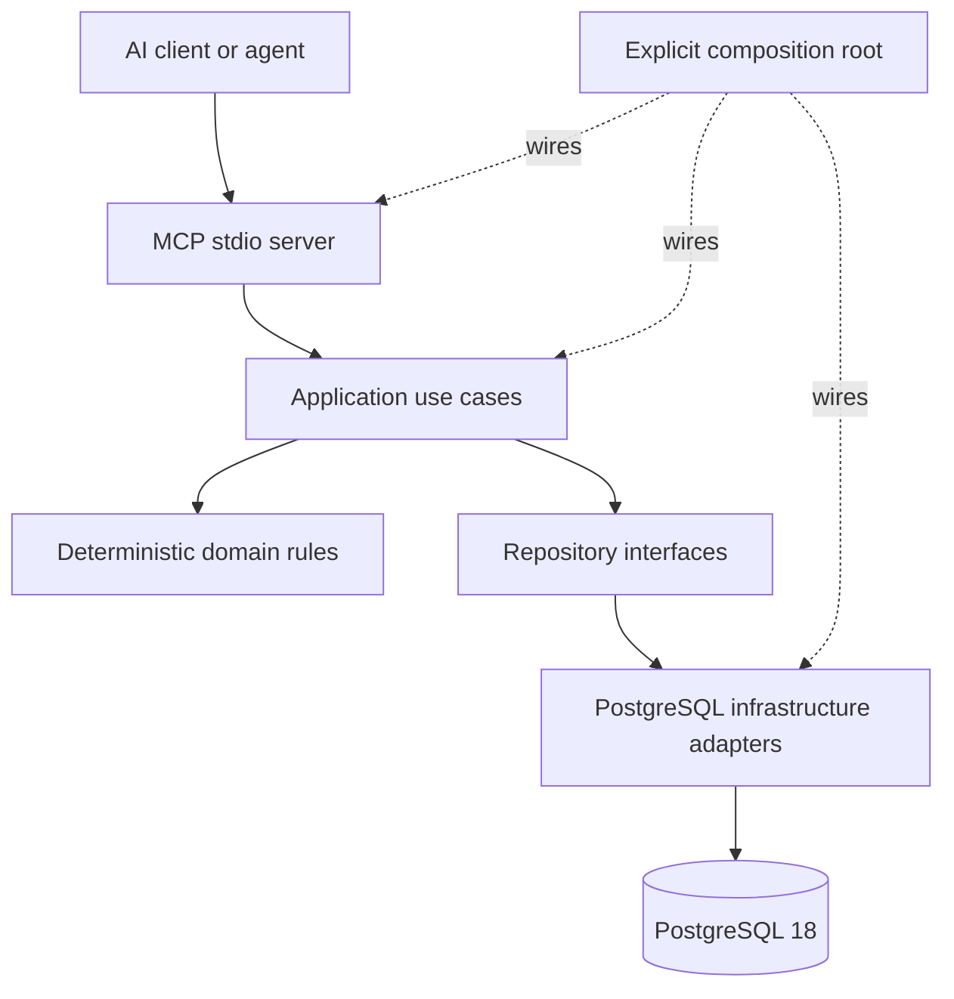
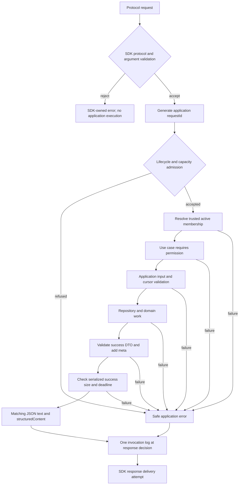
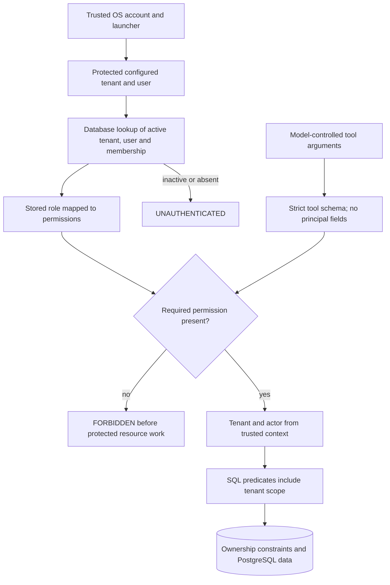
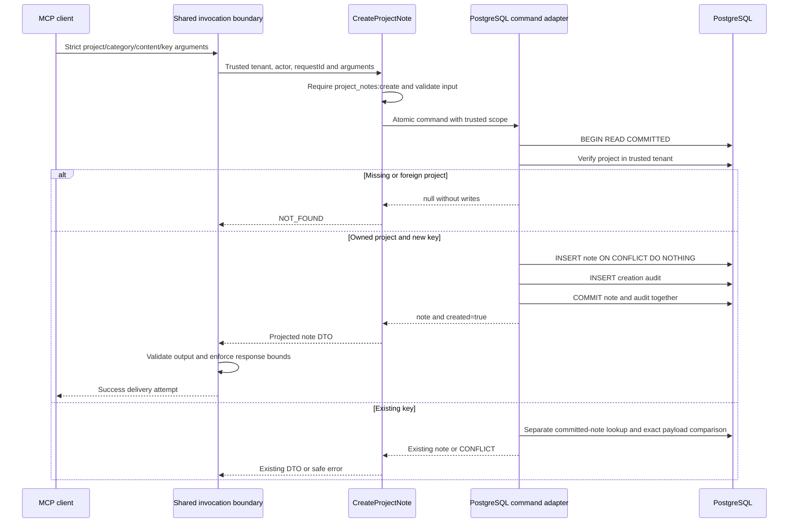
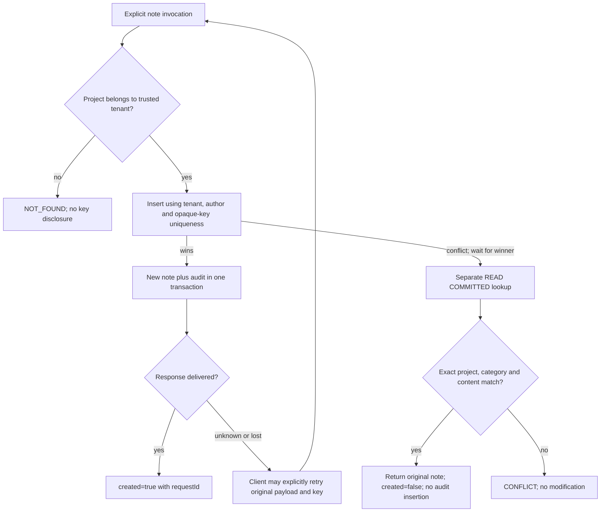
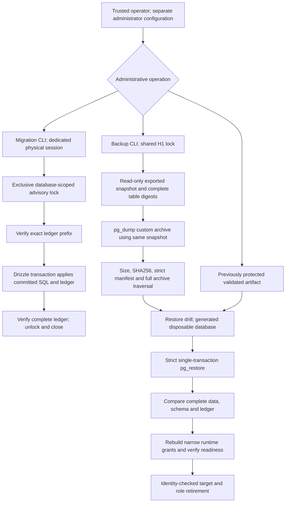

# Implemented architecture

Scope: main baseline 2e56b7a2aa61fa7b8bfa8102335a8e87df8338e7,
including M0-M7, M8-B through M8-F, and merged M8-H1/H2. M8-G is a
[separate draft](https://github.com/belovedjohndev/beloveddev-mcp/pull/2).
This document describes implemented behavior, not production approval.

## System architecture

Arrows describe runtime orchestration. Compile-time dependencies point inward:
application owns repository interfaces; infrastructure implements them. The domain
does not import MCP, Drizzle, configuration, or application orchestration. Domain
rules do not call repositories themselves. MCP is the interface layer. An AI
client may interpret results, but cannot set permissions or change evaluation rules.

| Location                                                                                      | Implemented responsibility                                               |
| --------------------------------------------------------------------------------------------- | ------------------------------------------------------------------------ |
| [apps/mcp-server/src/main.ts](../apps/mcp-server/src/main.ts)                                 | Parse configuration, construct dependencies, gate readiness, start stdio |
| [apps/mcp-server/src/lifecycle.ts](../apps/mcp-server/src/lifecycle.ts)                       | One bounded shutdown and in-flight accounting                            |
| [packages/mcp/src/server.ts](../packages/mcp/src/server.ts)                                   | Eight explicit SDK v2 registrations and shared invocation boundary       |
| [packages/mcp/src/schemas.ts](../packages/mcp/src/schemas.ts)                                 | Strict input/success-output contracts and safe error shape               |
| [packages/application/src/use-cases](../packages/application/src/use-cases)                   | Authorization, validation, orchestration, DTO projection                 |
| [packages/application/src/repositories.ts](../packages/application/src/repositories.ts)       | Explicit ports for implemented operations                                |
| [packages/domain/src/evaluation-policy-v1.ts](../packages/domain/src/evaluation-policy-v1.ts) | Versioned, pure fit rules and findings                                   |
| [packages/infrastructure/src/postgres](../packages/infrastructure/src/postgres)               | Tenant-scoped queries and the note/audit transaction                     |
| [packages/database/src](../packages/database/src)                                             | Schema, pools, readiness, migration/recovery administration              |

packages/shared remains metadata-only. There is no generic repository,
dependency-injection framework, event bus, background worker, or separate HTTP app.

## MCP request lifecycle

Unknown tools, malformed protocol requests and schema-invalid arguments are SDK
failures before the registered callback. They need no application request ID,
error envelope or invocation log. Valid calls enter the shared callback; request
IDs are server-generated. Application use cases require permission before their
own input parsing and protected resource access. Membership lookup itself is
infrastructure access needed to establish trusted context.

Success output is strictly validated and returned twice: JSON text content and
matching structuredContent, both with meta.requestId. Application failures return
isError=true and safe JSON error text, with no structuredContent because the
advertised output schema describes success. Raw SQL errors/stack traces are not
returned. The [tool reference](mcp-tool-contracts.md#shared-contract) describes the
actual envelopes and error codes.

[InvocationAdmission](../packages/mcp/src/invocation-policy.ts) is implemented
as InvocationAdmission: eight executing invocations, no queue, a 30-second
application response deadline, and 1,048,576 UTF-8 bytes for the complete serialized
success result, including both representations but excluding JSON-RPC framing.
The deadline is measured from callback entry; its timer is armed after admission
and covers context, work, output validation and serialization. Work can continue after a timeout and retains its slot until
settled. A late context resolution does not initiate new use-case execution.
These are not SDK framing limits, preemptive CPU cancellation or database-server
resource guarantees. Saturation returns RATE_LIMITED; shutdown refusal returns
INTERNAL_ERROR.

Main emits invocation records through logger.info for success and failure.
Records contain requestId, toolName, actorUserId, tenantId, durationMs,
resultStatus and errorCategory when applicable. Note content, keys and full bodies
are excluded. A successful log does not prove response delivery. Severity and
logging-failure hardening from M8-G is not merged; LOG_LEVEL=warn hides main's
invocation records. See [security limitations](security.md).

## Tenant authorization boundary

[LocalRequestContextProvider](../packages/infrastructure/src/local-request-context.ts)
revalidates membership per invocation; its [SQL adapter](../packages/infrastructure/src/postgres/membership-repository.ts)
also checks active user/tenant. Owner and member get all V1 permissions; viewer gets
profile:read, projects:read and opportunities:read only. These are operator-asserted
principals, not independently authenticated users. Main supports only local mode
and rejects NODE_ENV=production. No HTTP transport or OAuth is required for local stdio.

Resource lookups combine trusted tenant and resource ID in SQL. Missing and
cross-tenant project/opportunity lookups return NOT_FOUND; foreign list/search
filters return empty results. Joined project/client/evidence relationships retain
tenant predicates. Composite foreign keys protect same-tenant relationships even
in direct SQL. The database does not implement application authorization or RLS.
Compromised runtime credentials can access granted data across tenants.

Membership validation is a per-call check, not a transaction-held revocation lock.
An administrator may change role/membership/grants after the check. Startup
privilege/readiness checks are also point-in-time. The trusted host, protected
launcher, and trusted database administration remain essential assumptions.

## Note creation and audit transaction

The [command adapter](../packages/infrastructure/src/postgres/project-note-creation-repository.ts)
owns this transaction through one explicit application port, not separate
non-atomic note/audit services. The actual transaction also closes on the missing
project and retry branches; the diagram abbreviates those no-new-write endings.
The project lookup precedes any key lookup. PostgreSQL canonical project UUIDs
make equivalent uppercase/lowercase spellings the same identity.

The new audit stores tenant, actor, action project_note.created, resource type
project_note, note ID, invocation requestId, and exactly projectId/category metadata.
Content and opaque key are not audit metadata. The audit foreign key binds tenant,
note and author; uniqueness prevents a second creation audit. Historical notes
were not assigned invented audit records. Storage/audit errors before commit roll
back the transaction. A connection failure near COMMIT can leave the client
uncertain; no failure response proves rollback.

Output validation occurs after repository commit. It cannot reverse a committed
write. The same applies to output-size/deadline rejection, disconnect or lost
response. The client must preserve the key and exact payload.

## Idempotency and retry behavior

Uniqueness is (tenant_id, author_user_id, idempotency_key), across projects. There
is no update-on-conflict or automatic retry. The unique index arbitrates concurrent
calls; the losing insert waits, then a separate READ COMMITTED statement can see
the committed winner. Retries retain original note ID/time and original audit;
each invocation receives a new request ID. Changed content, category or owned
project conflicts. Authorization is required again on retries. This provides
idempotent effects within that scope, not exactly-once network delivery.

## Reads, pagination and deterministic evaluation

[Repository implementations](../packages/infrastructure/src/postgres) and
[application use cases](../packages/application/src/use-cases) define these orders:

| Capability        | Ordering / semantics                                                                                          |
| ----------------- | ------------------------------------------------------------------------------------------------------------- |
| Project pages     | UUID ASC; optional status/client and escaped literal name/summary substring                                   |
| Open blockers     | blocked_since ASC, UUID ASC; optional project/severity                                                        |
| Opportunity pages | coalesce(published_at, created_at) DESC, UUID DESC; exact status/source and escaped literal cross-field query |
| Evidence search   | English websearch_to_tsquery, ts_rank_cd DESC, evidence UUID ASC; any-member project/type/skill filters       |

[Signed cursors](../packages/infrastructure/src/signed-cursor.ts) use HMAC-SHA256
and constant-time signature comparison. They bind tenant, capability, supported
normalized filters and ordering position; evidence retains PostgreSQL's canonical
rank text and timestamp cursors retain microseconds. Cursors are opaque client
continuations, not encrypted or expiring credentials. Key rotation invalidates
old cursors. They do not provide snapshot isolation across changing pages.

Evidence uses a stored weighted tsvector and GIN index; no embedding/vector service
is involved. GetProject independently loads at most 20 evidence summaries, 20 open
blockers and 10 recent notes after loading the project. These parallel reads are
not one repeatable-read snapshot or complete history export.

[EvaluationPolicyV1](../packages/domain/src/evaluation-policy-v1.ts) normalizes
matching values deterministically and owns weights, thresholds, exclusions and
findings. Exclusion takes precedence over a preferred project type. Budget is
null because profile currency is absent; unavailable dimensions are excluded
from the weighted denominator. Evaluation is derived, never persisted and never
LLM-scored. [EvaluateOpportunity](../packages/application/src/use-cases/evaluate-opportunity.ts)
loads tenant-scoped opportunity/profile and at most ten evidence results. Its
1000-character quoted query prioritizes required skill phrases over preferred
ones and bounds fallback text. Omitted/shortened terms or another evidence page
emit evidence_retrieval_incomplete; incomplete retrieval cannot establish that
other evidence is absent or emit no_portfolio_evidence on that basis.

## Database migration and recovery workflow

[Migration execution](../packages/database/src/migrate.ts) owns one session and
holds advisory lock (0x42444556, 1) through preflight, Drizzle and postflight.
Defaults are connect 5s, advisory wait 10s, other lock wait 5s, statement 120s,
operation 300s plus at most 5s cleanup. Original applied SQL is never regenerated
or repaired in place. Drizzle ledger scaffolding may exist outside its DDL
transaction. Lost acknowledgements require manual investigation, not a rollback
assumption. The lock coordinates reviewed executors; arbitrary privileged SQL
can bypass it. See [migration operations](database.md#m8-h1-administrative-execution-policy).

[Recovery](../packages/database/src/recovery.ts) uses PostgreSQL 18 native clients,
a shared H1 lock and an exported consistent snapshot for table digests and dump.
The private new-only artifact contains archive.dump and strict manifest.json.
Validation traverses the whole archive, not just its TOC. A mutable manifest is
not authenticity, compression is not encryption, and archive validation is not
proof of a successful restore. Drills create no caller-selected target name and
never replace an existing database. They verify every application table and the
ledger, schema and restricted-role readiness before retiring generated targets;
the API supports bounded verification callbacks used by MCP integration tests.
Those callback tests are not automatic execution of all eight tools by every CLI
drill. Read the [runbook](recovery.md) for credentials, storage, deadlines,
cleanup failures and outstanding RPO/RTO/cutover decisions.

These administrative processes are outside MCP. Their credentials cannot fall
back to the runtime URL and must not enter the MCP environment. The application
startup only reads migration artifacts and probes PostgreSQL 18, identity,
schema/ledger and effective runtime privileges within ten seconds. It never
applies migrations or grants. There is no HTTP readiness endpoint.

## Process lifecycle and container boundary

The [lifecycle controller](../apps/mcp-server/src/lifecycle.ts) shares one stop
promise across SIGINT, SIGTERM, EOF/transport closure, database errors and partial
startup failure. It stops admission, gives admitted callbacks up to ten seconds,
and attempts transport and database cleanup independently. One 15-second deadline
also bounds stdout flushing; expiry/failure exits nonzero. Later fatal triggers
upgrade the exit status without repeating cleanup. Client-managed EOF is the
portable stop mechanism; SIGKILL and Windows forced termination cannot run handlers.
Timers require an available Node event loop. Database errors close the process;
there is no automatic process restart or mutation retry.

The [main Dockerfile](../Dockerfile) builds from a digest-pinned official Node 24
Bookworm base with locked workspace installs. Final artifacts contain production
dependencies, compiled code and original migrations, run as 1000:1000, and start
Node directly. The supported [container launch](local-stdio-container.md) uses a
read-only root, dropped capabilities, no-new-privileges and runtime-only secrets.
It preserves the local identity restrictions, verified database TLS and bounded
readiness/lifecycle. No distroless/Trixie candidate or M8-G scanner policy is
imported here. Nonroot packaging is not a vulnerability-free or production-approved image.

## Verification and limits

Domain/application tests isolate rules and orchestration; MCP contracts use SDK
in-memory transport; repository/stdio/migration/recovery tests use real PostgreSQL
and restricted runtime credentials. The [current CI definition](../.github/workflows/ci.yml)
runs verify:all, migration-generation drift checking and separate container smoke.
It does not yet include M8-G dependency/scanner enforcement. See the
[case study](case-study.md#verification) for commit-qualified results and what was
actually rerun for M9-A, and the [security disclosure](security.md) for remaining
trust assumptions and release blockers.
